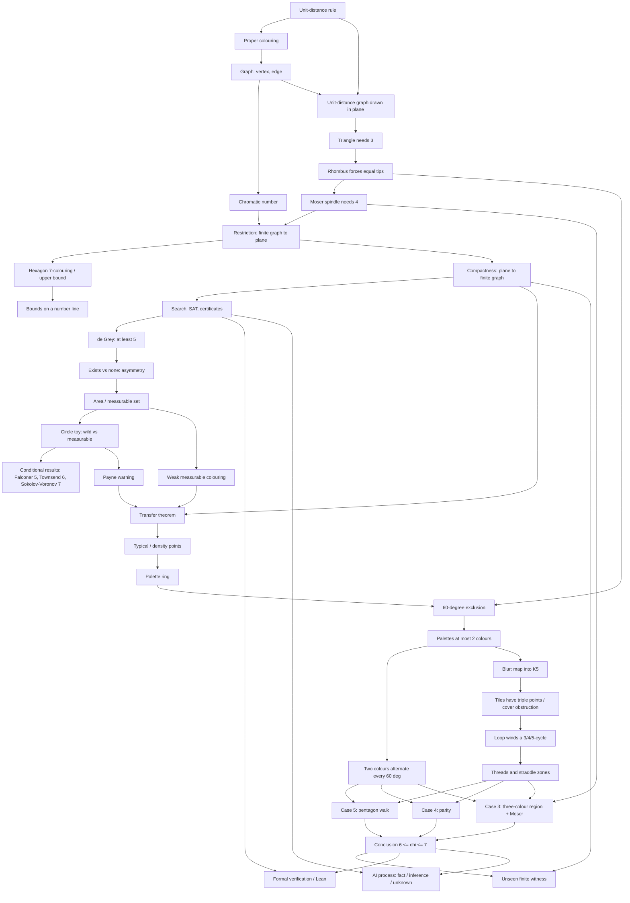

# Concept dependency graph

Rule: no concept appears in the script before all of its prerequisites. Column "Ch" is the chapter where
the concept is first introduced (see `scripts/outline.md`). QA phase re-checks the script against this table.

| ID | Concept | Prerequisites | Ch | Source |
|---|---|---|---|---|
| C1 | Unit-distance rule ("exactly 1 apart ⇒ different") | none | 1.1 | P §1 |
| C2 | Proper colouring | C1 | 1.2 | P §1 |
| C3 | Graph: vertex, edge | C2 | 2.1 | standard |
| C4 | Chromatic number | C3 | 2.1 | P §1 |
| C5 | Unit-distance graph drawn in the plane | C1, C3 | 2.1 | P §1 |
| C6 | Triangle ⇒ ≥ 3 | C5 | 1.3 (felt), 2.2 (named) | standard |
| C7 | Rhombus ⇒ far tips equal (√3 apart) | C6 | 2.3 | P §8 (Moser text) |
| C8 | Moser spindle ⇒ ≥ 4 | C7 | 2.3 | MoserMoser1961; P §8 |
| C9 | Restriction: finite graph needs N ⇒ plane needs N | C4, C8 | 2.4 | standard |
| C10 | Hexagon 7-colouring | C9 | 3.1 | P §1 proof of Thm 1.1 |
| C11 | Bounds number line (4–7, 1950–2018) | C10 | 3.1 | P §1; Soifer |
| C12 | Compactness (de Bruijn–Erdős) | C9 | 3.2 | P §1 |
| C13 | Search, SAT, refutation certificate | C12 | 3.3 | Heule2018 |
| C14 | de Grey ≥ 5; later 553, 509, human-verifiable | C13 | 3.3 | deGrey2018; P §1 |
| C15 | Existence vs non-existence asymmetry; search stalls | C14 | 4.1 | Heule2018; P §1 |
| C16 | Area / measurable set (informal) | C15 | 4.2 | standard |
| C17 | Circle toy (wild vs measurable) | C16 | 4.2 | toy T2; P Lemma 6.4 mechanism |
| C18 | Conditional results: measurable ≥ 5 (1981), map ≥ 6, polygonal ≥ 7 | C17 | 4.3 | P §1 |
| C19 | Payne warning (2 vs ≥ 5) | C17 | 4.3 | Payne2009 via P §1 |
| C20 | Weak measurable colouring | C16 | 5.1 | P Def 1.2 |
| C21 | Transfer theorem (averaging, rigidity as black box, density points) | C12, C19, C20 | 5.1 | P Thm 1.3, §§2–4 |
| C22 | Typical (density-one) points | C21 | 5.1 | P Lemma 4.3 |
| C23 | Palette ring at a centre | C22 | 5.2 | P Def 5.1 |
| C24 | 60° exclusion | C7, C23 | 5.2 | P Cor 5.4 |
| C25 | ≤ 2 colours per direction | C24 | 5.2 | P Prop 5.6 |
| C26 | Two-colour alternation every 60° | C25 | 5.2 | P §5.3 |
| C27 | Blur ⇒ map into K₅ | C25 | 5.3 | P §7.1–7.2 |
| C28 | Triple points / cover obstruction | C27 | 5.3 | P Lemma 7.5 |
| C29 | Loop winds a 3/4/5-cycle | C28 | 5.3 | P Lemmas 7.6–7.7 |
| C30 | Threads and straddle zones | C29 | 5.3 | P Prop 7.1, Fig 2 |
| C31 | Case 5: pentagon walk | C26, C30 | 5.4 | P Prop 8.2 |
| C32 | Case 4: parity | C26, C30 | 5.4 | P Prop 8.5 |
| C33 | Case 3: three-colour region + Moser certificate | C8, C26, C30 | 5.4 | P Prop 8.10, Lemmas 8.8–8.9 |
| C34 | 6 ≤ χ ≤ 7 | C31–C33 | 5.5 | P Thm 1.1 |
| C35 | Unseen finite witness | C12, C34 | 5.5 | P Cor 1.5 proof |
| C36 | Formal verification, Lean | C13, C34 | 7 | lean/* |
| C37 | AI process facts / inferences / unknowns | C13, C34 | 6 | README; brief §7 |

Note on Act order: Act 6 (AI) precedes Act 7 (verification) as the prompt requires. C37 uses only the
*idea* of checking from C13 (certificates). The full Lean explanation (C36) comes in Act 7, so Act 6 says
"we'll see how this is checked next" rather than explaining Lean.
